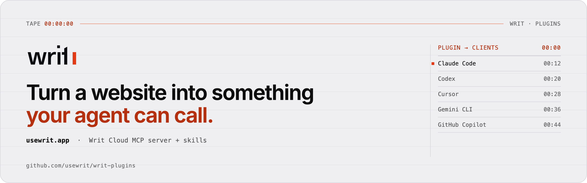

  <a href="https://usewrit.app"><picture>
    <source media="(prefers-color-scheme: dark)" srcset="./assets/cover-dark.png">
    
  </picture></a>

  

    <a href="https://usewrit.app"><b>usewrit.app</b></a> ·
    <a href="https://usewrit.app/docs/mcp/"><b>Docs</b></a> ·
    <a href="#install"><b>Install</b></a> ·
    <a href="#what-this-plugin-adds"><b>What it adds</b></a> ·
    <a href="https://usewrit.app/privacy/"><b>Privacy</b></a>
  

# Writ

Writ turns a website into something you can call: read a page, collect a site, build a real API from it, or run a task on a site the user is signed in to.

Writ does the web tasks a chat assistant cannot do on its own: a task on the user's own signed-in account on a website (email, social, shop, bank or work portal), a click, form or submit on a site, or a page that only renders in a real browser. Writ runs a real cloud browser and signs in with the user's saved identity; the model never sees or asks for a password.

Writ fits when:
- the site has no API, or its API does not return what was asked for
- the user wants an endpoint of their own: something their code, their spreadsheet or another agent can call later, not a one-off answer
- the data is behind the user's own sign-in, two-factor included: Writ keeps the login sealed server-side, and the model never sees a credential
- the job will come back: record it once and every later run replays without a browser and without AI
- the user wants to be told when a page changes — a price, a listing, a status

## Try it

- "Summarize the top 3 stories on Hacker News right now."
- "Turn quotes.toscrape.com into an API that returns quotes by page."
- "Collect every book in the Travel category of books.toscrape.com as a dataset."
- "Tell me by email when the price on this product page changes."

## What this plugin adds

- **The Writ Cloud MCP server** at `https://api.usewrit.app/mcp?payments=off` (Streamable HTTP). Your client signs in with OAuth the first time a Writ tool runs; no API key is stored in any file.
- **10 skills** that teach the agent when and how to use each Writ tool:

| Skill | Use it for |
| --- | --- |
| `writ-automations` | Build Writ automations that react to events: when a workflow or crawl finishes or fails, when a watched page changes, when another system calls a signed webhook URL, or on a clock, then run a workflow (or chosen functions), send a notification with the collected data, wake an AI agent, or run a multi-step flow with scrape, extract and condition blocks. |
| `writ-browser-tasks` | Do a task on a website in a real Writ cloud browser (click, fill a form, submit, search inside an app, change a setting, book or post) and record it as a reusable workflow when it will come back. |
| `writ-collected-data` | Answer questions from data Writ has already collected, without running anything. Search across every workflow's and crawl's results, read a dataset as a table, fetch full records, shape rows for a program, and export CSV or JSON. |
| `writ-desktop-devices` | Run Writ work on the user's own computer through a linked Writ desktop app instead of the cloud, with their own browser, logins, local vault and IP address. |
| `writ-fix-workflows` | Diagnose and repair a saved Writ workflow that returns nothing, fails or has drifted, and edit a workflow in place (settings, persona, steps, functions, schedule and its agent skill). |
| `writ-http-functions` | Build browserless API functions in Writ from a site's real network requests or its server-rendered HTML, so a saved workflow runs over plain HTTP with no browser and no AI. Covers capturing requests, defining and live-testing named functions, sign-in and token chains, row extraction from HTML or JSON, cursor pagination and multi-request flows. |
| `writ-read-and-crawl` | Read web pages and collect whole sites or sections into datasets with Writ. |
| `writ-signed-in-sites` | Work on websites where the user is signed in, through Writ personas (saved sign-in identities whose passwords and 2FA stay sealed in Writ). |
| `writ-watch-and-schedule` | Watch web pages for changes with Writ monitors and run saved workflows or crawls on a schedule. |
| `writ-website-to-api` | Turn a website into a callable API with Writ, then run, prove, publish and repair it. |

The plugin contains only these manifests, the skills (Markdown) and an icon. It runs no local code, hooks or scripts.

## Install

| Client | How |
| --- | --- |
| Claude Code | `/plugin marketplace add usewrit/writ-plugins` then `/plugin install writ@usewrit` |
| Claude (claude.ai, Desktop, Cowork) | the Claude plugin directory, or Settings -> Connectors -> add `https://api.usewrit.app/mcp?payments=off` |
| ChatGPT | the ChatGPT plugin directory, or Settings -> Connectors -> Create (developer mode) -> `https://api.usewrit.app/mcp?payments=off` |
| Codex | `codex plugin marketplace add usewrit/writ-plugins` |
| Gemini CLI | `gemini extensions install https://github.com/usewrit/writ-plugins` |
| Cursor | the Cursor marketplace, or the MCP server alone: `cursor://anysphere.cursor-deeplink/mcp/install?name=writ-cloud&config=eyJ1cmwiOiAiaHR0cHM6Ly9hcGkudXNld3JpdC5hcHAvbWNwP3BheW1lbnRzPW9mZiJ9` |
| VS Code / GitHub Copilot | `copilot plugin install usewrit/writ-plugins`, or the MCP server alone from the GitHub MCP registry |

## What it sends and fetches

- The agent's tool calls go to `https://api.usewrit.app` over HTTPS, authenticated with the OAuth token of your Writ account. Nothing else is contacted by the plugin.
- Writ's cloud (or your own linked Writ desktop, when you choose it) fetches the web pages, runs the browsers and stores the data your workflows and crawls collect, in your Writ account.
- Sign-ins are saved in Writ as personas: passwords and 2FA secrets stay sealed on Writ's side (or in your desktop's vault) and never pass through the model or the conversation.
- Tools that can change something — act in a browser, run a workflow that writes, edit a saved workflow — are annotated as such, so your client asks before running them.
- Money: this plugin places no order and moves no money. Its connection (`?payments=off`) has no payment tool and no purchase option, and the agent fills a cart only up to the checkout page, which the user finishes on the store's site. Purchases, bill payments and transfers are left to the user; purchases and payment workflows are set up by the user in the Writ app.

## Staying within each site's terms

Writ signs in only with the user's own saved accounts, crawls honor robots.txt by default, a CAPTCHA or "confirm it's you" check is handed to the user to complete, and nothing places an order or moves money from the chat. The user stays responsible for using each site within its terms.

Privacy policy: https://usewrit.app/privacy · Terms: https://usewrit.app/terms · Support: https://usewrit.app/contact (support@usewrit.app)

## License

MIT — see [LICENSE](LICENSE).
